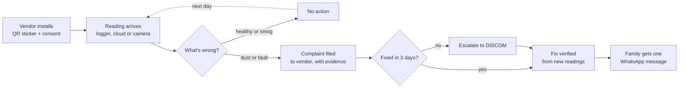
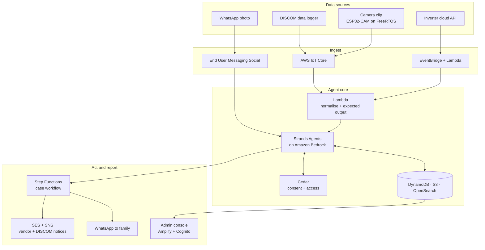

<div align="center">

<h1>
  <picture>
    <source media="(prefers-color-scheme: dark)" srcset="packages/ui/brand/suryasaathi-logo-dark.svg">
    
  </picture>
</h1>

**An AI agent that keeps India's rooftop solar working.**

It watches every roof, works out why output dropped (smog, dust or a fault), files free-maintenance claims with the vendor, and escalates to the DISCOM when the vendor doesn't show up. Families never install an app: they get one WhatsApp message when it's fixed.

Built by **Team Mythos** for Environmental Hacks 2026

[Live demo](#try-the-demo) · [Video](https://www.youtube.com/watch?v=m6HiN65kmdo) · [Architecture](#architecture) · [Getting started](#getting-started) · [Roadmap](#roadmap)


<!--
  Demo screenshot: hidden until docs/assets/demo.png exists. Add a real screenshot or GIF
  of the demo at that path, then move the  tag below out of this comment.
  
-->

</div>

---

## Table of contents

- [The problem](#the-problem)
- [What SuryaSaathi does](#what-suryasaathi-does)
- [Try the demo](#try-the-demo)
- [How it works](#how-it-works)
- [Architecture](#architecture)
- [Why each AWS service](#why-each-aws-service)
- [Repository structure](#repository-structure)
- [Getting started](#getting-started)
- [Configuration](#configuration)
- [Data, consent and privacy](#data-consent-and-privacy)
- [Roadmap](#roadmap)
- [Hackathon notes](#hackathon-notes)
- [Contributing](#contributing)
- [License](#license)
- [Acknowledgements and sources](#acknowledgements-and-sources)

---

## The problem

India has installed rooftop solar on **50 lakh+ homes** under PM Surya Ghar (14.8 GW commissioned), but almost nobody checks whether those systems keep producing after installation. Industry experts estimate **99% of users stop monitoring** once the installer leaves.

When output drops, families can't tell why. There are three common causes, and they look the same on the electricity bill:

| Cause | Whose problem | What should happen |
| --- | --- | --- |
| Smog in the air | Nobody's | Nothing; output recovers when the air clears |
| Dust on the panels | The vendor's | Free cleaning, owed for 5 years |
| Inverter or wiring fault | The vendor's | Free repair, owed for 5 years |

The vendor's easy answer every winter is "it's the pollution." In Delhi, dust alone can cost 0.3–0.6% of output per day, and North Indian systems can lose 17–25% a year even with monthly cleaning. Families lose money, the free maintenance they're owed goes unclaimed, and clean energy the country already paid for is never produced.

**Why now:** Delhi's Solar Energy Policy (Second Amendment, September 2026) makes DISCOMs responsible for monitoring generation and identifying under-performing systems, and gives every system a Digital Solar Asset Identification Number (DSAIN). The duty exists; the tool doesn't. SuryaSaathi is that tool.

## What SuryaSaathi does

Every day, for every roof:

1. **Collects** yesterday's generation automatically: from a DISCOM data logger, the inverter maker's cloud, or a small camera clip that reads the inverter screen. A WhatsApp photo is the fallback.
2. **Compares** it with what that exact roof should have made, using satellite sunlight and haze data for that location and day.
3. **Diagnoses** the cause: smog (output and expected fall together), dust (the gap widens every dry day and rain resets it) or a fault (output collapses overnight).
4. **Acts**: ignores smog, files a free-maintenance claim with evidence for dust or faults, tracks the vendor's deadline, and escalates to the DISCOM if it's missed.
5. **Verifies** the fix from new readings, then sends the family one WhatsApp message in their language.

| Who | Channel | What they do |
| --- | --- | --- |
| Families | WhatsApp only | Nothing. One-time consent at installation; optional replies or voice notes |
| Vendors | Email + SMS to their helpline | Fix the issue before the deadline |
| DISCOM admins | Web console | Review the vendor leaderboard and work the escalation queue across 10–20 lakh systems |

## Try the demo

The public demo needs no login: **[suryasaathi demo →](#)** <!-- replace with the deployed URL -->

It replays 30 days on one 3 kW rooftop in Dwarka, Delhi:

- Switch the data source between **Data logger**, **Inverter cloud** and **Camera clip** and watch the device message change.
- Trigger **rain**, **smog** or an **inverter fault** and see how the agent reacts.
- Toggle whether the vendor fixes on time, and watch a case escalate to the DISCOM.

Readings in the demo are simulated, built on real Delhi weather patterns. Live agent calls from the public demo are rate-limited.

## How it works



### Diagnosis rules (v1)

- **Performance** = actual ÷ expected, where expected already includes that day's haze.
- **Smog:** expected is low but performance stays above 90%. No action.
- **Dust:** 3-day average below 91% and falling over 5 dry days. Closes on its own if rain restores it.
- **Fault:** performance drops below 60% overnight, or the inverter reports a fault code.
- **Verified fix:** performance back above 93% after the visit.

The rules are deliberately simple and explainable; every agent decision is logged with its reason.

## Architecture



The whole stack is defined in **AWS CDK**. At 20 lakh systems the console never scans raw readings: a nightly job rolls readings and cases into summary tables by vendor, zone and day.

## Why each AWS service

### AWS open source

| Tool | Job in SuryaSaathi |
| --- | --- |
| [Strands Agents SDK](https://strandsagents.com) | Runs the diagnosis, accountability and messenger agents and their tools |
| [Cedar](https://www.cedarpolicy.com) | Enforces consent and access: a vendor sees only its customers, a DISCOM its zone, a family its own data |
| [OpenSearch](https://opensearch.org) | Searchable inverter manuals and fault codes for the diagnosis agent |
| [AWS CDK](https://aws.amazon.com/cdk/) | The whole stack as code; one command deploys it |
| [FreeRTOS](https://www.freertos.org) | Runs on the camera-clip hardware (production design) |

### AWS services

| Service | Job | Why this one |
| --- | --- | --- |
| AWS IoT Core | Receives device readings over MQTT | Per-device certificates; scales to millions of devices; IoT rules route messages without servers |
| AWS Lambda | Ingest, expected output, connectors, rollups | Pay per run; no idle servers for a once-a-day workload |
| Amazon Bedrock | Agent reasoning, reading screen photos, messages in Hindi and English | Managed models with vision; no model hosting |
| Amazon DynamoDB | Systems, readings, consent and cases | Millisecond lookups by system ID at any scale; TTL ages out raw readings |
| Amazon S3 | Photos, evidence files, daily rollups | Cheap, durable evidence attached to every complaint |
| AWS Step Functions | Complaint → deadline → escalation → verification | Waits days for a vendor at near-zero cost; a visual audit trail per case |
| Amazon EventBridge | Daily expected-output runs, connector pulls, nightly rollups | Serverless schedules |
| AWS End User Messaging Social | WhatsApp in and out | Connects a WhatsApp Business account directly to AWS |
| Amazon Transcribe | Hindi voice notes to text | Families can just talk |
| Amazon SES + SNS | Complaint emails and SMS to vendors; escalation notices | Reliable delivery with a record of every notice |
| AWS Amplify + Amazon Cognito | Hosts the web apps; admin sign-in | Git-based deploys; role-based access |
| Amazon CloudWatch | Logs, metrics and alarms for every agent run | Observability, and proof the system is running |

## Repository structure

A single monorepo: **pnpm workspaces + Turborepo** for TypeScript, **uv** for Python.

```
suryasaathi/
├── apps/
│   ├── web/                # Marketing site + public demo (Next.js, HeroUI v3, Liveline)
│   └── console/            # DISCOM admin console (Next.js, HeroUI v3, cmdk, Cognito)
├── services/
│   ├── agents/             # Strands agents: diagnosis, accountability, messenger (Python)
│   ├── ingest/             # IoT rule handler and source connectors (Python)
│   ├── expected-output/    # Expected generation from sunlight + haze (Python, pvlib)
│   ├── whatsapp/           # End User Messaging Social webhook (Python)
│   ├── rollups/            # Nightly aggregation for the console (Python)
│   └── console-api/        # Read-only API for the console behind Cognito (Python)
├── packages/
│   ├── schemas/            # Shared JSON schemas: reading, system, case (+ generated TS types)
│   ├── console-data/       # Console data access: mock (engine) and API adapters
│   ├── ui/                 # Shared HeroUI theme, tokens and components
│   └── policies/           # Cedar policies and tests
├── infra/                  # AWS CDK app (TypeScript)
├── tools/
│   ├── device-sim/         # Virtual device: sends simulated readings to AWS IoT Core
│   └── firmware/           # ESP32-CAM camera-clip firmware (production design)
├── docs/                   # Architecture notes, decision records, assets
└── .github/                # CI workflows, issue and PR templates
```

### Frontend stack

- **[HeroUI v3](https://heroui.com)** on React Aria and Tailwind CSS v4, for accessible components with one shared theme in `packages/ui`.
- **[Liveline](https://benji.org/liveline)** for live expected-vs-actual charts in the demo and console.
- **[cmdk](https://www.npmjs.com/package/cmdk)** for the console's command palette (jump to a system, vendor or case).
- **Next.js** on AWS Amplify Hosting.

## Getting started

### Prerequisites

- Node.js 20+ and [pnpm](https://pnpm.io) 9+
- Python 3.12+ and [uv](https://docs.astral.sh/uv/)
- An AWS account with Amazon Bedrock model access enabled in your region
- AWS CLI v2, configured with credentials
- AWS CDK v2 (`npm i -g aws-cdk`)

### Install

```bash
git clone https://github.com/rahulsainlll/SuryaSaathi.git
cd SuryaSaathi
pnpm install          # JS/TS workspaces
uv sync               # Python services
```

### Run locally

```bash
pnpm dev --filter web        # marketing site + demo on http://localhost:3000
pnpm dev --filter console    # admin console on http://localhost:3001
```

The demo runs fully in the browser with simulated data, so no AWS account is needed to try it locally.

### Deploy to AWS

```bash
cd infra
cdk bootstrap                            # once per account and region
cdk deploy --all -c demoMode=true        # Docker must be running; demo mode = 1-minute days
```

### Send simulated readings

```bash
uv run tools/device-sim fetch-cert                        # the simulator's IoT certificate
uv run tools/device-sim --systems 5 --days 30 --speed 60
```

This replays the five golden scenarios (dust, smog, fault, rain, vendor misses the deadline)
to AWS IoT Core over MQTT, so you can watch cases open, escalate and close in DynamoDB, Step
Functions and CloudWatch. The [runbook](docs/runbook.md) has every step, the flags, what to
expect and where to look.

## Configuration

Copy `.env.example` to `.env` in each app or service. Key settings:

| Variable | Used by | Description |
| --- | --- | --- |
| `AWS_REGION` | all | Deployment region |
| `BEDROCK_MODEL_ID` | agents | Model used by the Strands agents |
| `IOT_ENDPOINT` | device-sim | Your AWS IoT Core data endpoint |
| `WHATSAPP_PHONE_NUMBER_ID` | whatsapp | Number linked in End User Messaging Social |
| `VENDOR_DEADLINE_DAYS` | agents | Days a vendor has to fix an issue (default 3) |
| `NEXT_PUBLIC_DEMO_API` | web | Rate-limited endpoint for live agent calls from the public demo |

Never commit real credentials. Secrets live in AWS Secrets Manager or SSM Parameter Store.

## Data, consent and privacy

- **Consent first.** Readings are collected only with the household's one-time consent, recorded at installation and enforced by Cedar before every agent tool call.
- **Least access.** Vendors see only their own customers; DISCOM admins see only their zone; families own their data.
- **QR stickers carry an opaque ID**, never personal data.
- **Simulated data.** All data in this repository and the public demo is simulated. No real household data is included.

## Roadmap

- [x] Problem research and product design
- [x] Device and agent simulator (browser)
- [ ] Ingest: IoT Core → Lambda → DynamoDB
- [ ] Expected-output service on real sunlight and haze data
- [ ] Strands diagnosis agent on Bedrock
- [ ] Step Functions case workflow with escalation
- [ ] Public demo on the marketing site
- [x] Admin console with vendor leaderboard
- [ ] WhatsApp messaging and Hindi voice notes
- [ ] Production connectors: DISCOM data (India Energy Stack), inverter clouds
- [ ] Camera-clip firmware on ESP32-CAM

## Hackathon notes

Built for **Environmental Hacks** (Waste and Energy track), part of the Bharat Builds Tour by WeMakeDevs × AWS, October 2026.

**AI tools used:** Claude and Claude Code for research, design and code. <!-- update with every AI tool the team used, as the rules require -->

**Team Mythos:**

| Member | GitHub |
| --- | --- |
| Rahul Sain | [@rahulsainlll](https://github.com/rahulsainlll) |
| Yukti | [@Kiarstein](https://github.com/Kiarstein) |
| Mayank Dhokal | [@mayankdhokal](https://github.com/mayankdhokal) |

## Contributing

Contributions are welcome. Please open an issue first to discuss what you'd like to change, and read [`CONTRIBUTING.md`](CONTRIBUTING.md) before opening a pull request. Commits follow [Conventional Commits](https://www.conventionalcommits.org).

## License

[MIT](LICENSE)

## Acknowledgements and sources

- UI built with [HeroUI](https://heroui.com), [Liveline](https://benji.org/liveline) and [cmdk](https://www.npmjs.com/package/cmdk).
- Expected output modelled with [pvlib](https://pvlib-python.readthedocs.io), using [NASA POWER](https://power.larc.nasa.gov) sunlight data and [Open-Meteo](https://open-meteo.com) air quality and weather data.

Sources for the figures above:

- PM Surya Ghar progress: [pv magazine India](https://www.pv-magazine-india.com/?p=16188)
- Users who stop monitoring: [ETV Bharat](https://etvbharat.com/en/bharat/rooftop-solar-push-under-pm-surya-ghar-yojana-crossed-37-lakh-but-maintenance-a-challenge-enn26070705272)
- Dust losses in Delhi: [Renewable Watch](https://renewablewatch.in/2018/12/22/soiling-analysis/)
- Vendor maintenance duty: [Delhi Solar Portal](https://solar.delhi.gov.in/page/operation-and-maintenance-procedure), [REC framework](https://renewablewatch.in/2024/11/28/rec-releases-guidelines-for-vendor-operations-under-pm-surya-ghar/)
- Delhi policy, Second Amendment: [summary](https://advocategandhi.com/delhi-solar-energy-policy-2023-gets-major-second-amendment-new-rooftop-solar-subsidies-free-solar-for-eligible-households-and-discom-trusteeship-model-introduced/)
